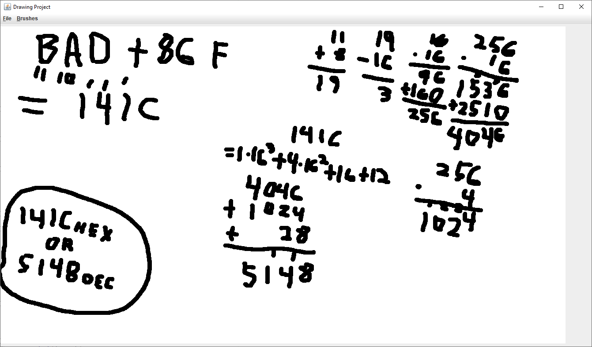
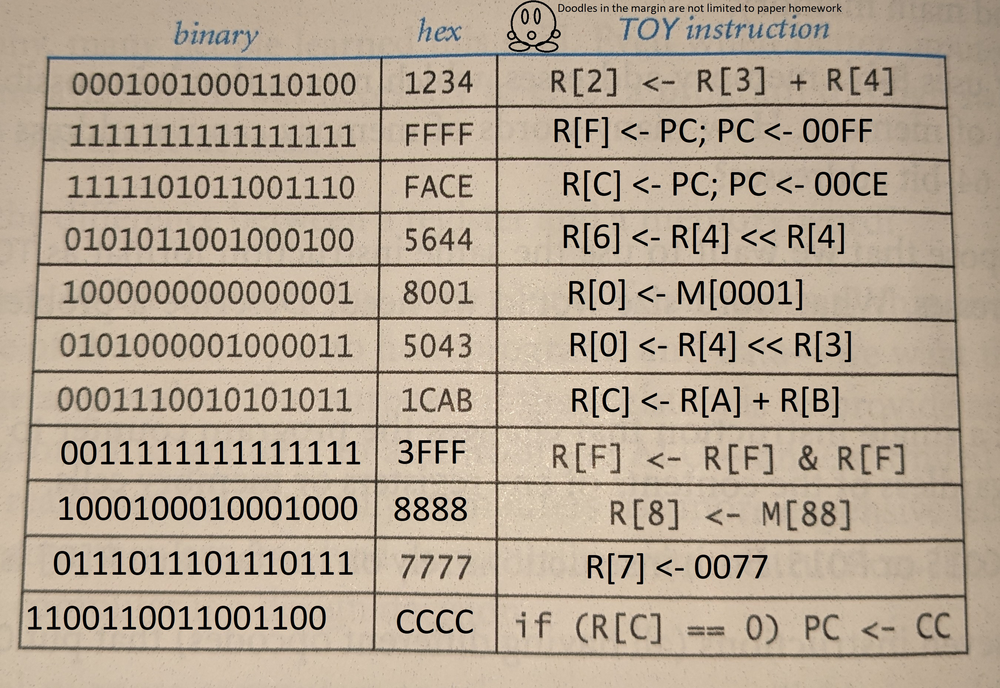

# 1- Hexadecimal addition

Adding the two numbers together wasn't hard. Converting it to decimal which I wasn't required to do yet still decided to was the fun part.
# 2- Examples of programs treated as data
Practically all programs now and days ARE data. That is how they are created, transferred, and stored. The term program to me is almost synonymous with the term software, and all software is binary code. Some quick and simple examples of programs as data would be:
### Videogames and CDs.
Videogames have more or less lost all sense of physical form with the advent of digital marketplaces, where you can simply download them, but to make my point clearer I want to focus on video games as they were when stored on CDs. CDs are exclusively data storage devices. They have small bumps and ridges read by laser that correspond to binary data. Videogames, which have a large variety of instructions and mechanics, have all of that distilled into a data form as to be put onto those disks so that they can be transferred to a machine that can read, store, and run those instructions.
To a CD, there is no difference between a videogame or any other program, and data. Even the machine that reads it may not care, depending on the machine of course.
### Git
The main concept of git is storing the history of a file by saving the differences between it's different iterations. In this regard, any program committed to git is never treated as a program by git. It is exclusively treated as data of which to compare and contrast to another iteration of the same data.
### All Written code
All written code are sets of instructions written down in some form. Prior to compiling and arguably even after, this written code exists in the form of a text file. A text file is nothing more than a holder of text characters, a container of data. Since it's just a text file, it can be used and treated like any other text file. This text file could be used for any number of purposes. I could write a program that takes a text file and uses it to generate pseudo random numbers. I could write a program that uses it's own text file to generate pseudo random numbers. Any instruction encoded into any language is turned into and can be used as data.
# 3- Toy instructions

The font they used for this is strangely close to Calibri, which is the font I used since it's the default.
